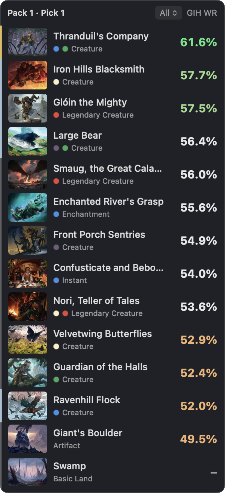

# Ponder

**17Lands win rates next to every card you're offered in MTG Arena, while you draft.**

Ponder is a small native macOS panel that docks to the side of Arena's draft screen. Every time
a pack opens, it lists that pack's cards ranked by their
[17Lands](https://www.17lands.com) **GIH WR** (games-in-hand win rate), with card art, colours,
rarity and a colour scale showing how far each card sits above or below the rest of the set.

<p align="center">
  
</p>

- **Follows your draft by itself.** It reads Arena's log file as you pick, so there's nothing
  to copy, paste or click.
- **Stays out of the way.** It shows only while Arena is in front and a pick is waiting, and
  follows Arena into fullscreen. It never takes focus from the game.
- **Hover a row to see the full card**, beside the panel on whichever side has room.
- **Fresh numbers.** Ratings come straight from 17Lands and refresh every few hours, so a new
  set's data fills in as people play it.
- **Read-only.** Ponder uploads nothing and needs no account or token.

The name comes from [Ponder](https://scryfall.com/search?q=%21ponder), the blue spell that
lets you look at your next cards before you commit to one. It's a sibling of
[Recall](https://github.com/fredoliveira/recall), which is named after Ancestral Recall.

## Install

1. Download `Ponder.dmg` from the [latest release](../../releases/latest) and drag Ponder to
   Applications. It's signed and notarized, and runs on Apple Silicon and Intel Macs with
   macOS 14 or later.
2. In Arena, turn on **Detailed Logs**: gear icon → Account → "Detailed Logs".
   Without it, Arena doesn't write draft picks to its log, and Ponder has nothing to show.
3. Open Ponder. A two-cards icon appears in the menu bar, and the panel appears next time you're
   picking a card.

Start a draft in Arena, or rejoin one in progress: Ponder reads the log from the start, so it
picks up where you are.

## Using it

The panel hangs off the right edge of Arena's window, below the draft header, and shows only
while Arena is the active app and a pack is on screen.

The menu-bar icon (two angled cards) has the rest:

| Menu item | What it does |
|---|---|
| Last update | How long ago the ratings were fetched from 17Lands (they refresh every 3 hours) |
| Size | 100% or a more compact 80% |
| Ratings from | Whose games the win rates come from: all players, or 17Lands' top, middle or bottom players (also switchable from the panel header) |
| Quit | Close Ponder |

### Reading the panel

- **The big number** is the card's GIH WR: how often decks won games in which the card was
  drawn or in the opening hand. A dash means 17Lands doesn't have enough games yet.
- **Its colour** shows how the card compares with the set's average:
  bright green for standouts, light green for above average, white for average, then orange and
  red below. The bands are in standard deviations from the set mean, so they mean the same thing
  in every set.
- **The bar on the left edge** marks rarity: orange for mythic, gold for rare, silver-blue for
  uncommon.
- **The dots** are the card's colours.

### Whose win rates

By default the numbers come from every player 17Lands has data for. You can instead use 17Lands'
top, middle or bottom players, grouped by their own win rate: click the panel's header to cycle
All → Top → Middle → Bottom, or pick one under **Ratings from** in the menu. Top
players' numbers show what a card does in strong hands, which can rank a pack quite differently.
The header shows the group in use; it is dimmed for a moment while that group's numbers load,
and Ponder remembers your choice.

Ponder always sticks to the group you chose, because win rates differ a lot between groups and
mixing them would show the same card at very different numbers from one pack to the next. The
smaller groups take a while to fill in after a set comes out, so expect more dashes there early
on.

Ratings are for the format you're drafting, too. Formats with less play, like Quick Draft, can
have no numbers at all for a while after release. Ponder then uses Premier Draft for the whole
set instead, and says so in orange in the header.

## How it works

Two small programs run together, both inside `Ponder.app`:

- **`ponder-feed`** (Rust, in [`feed/`](feed)) follows Arena's `Player.log` using
  [Recall](https://github.com/fredoliveira/recall)'s log parser and prints each pack and pick as
  a line of JSON.
- **Ponder** (Swift and AppKit, in [`Sources/Ponder/`](Sources/Ponder)) reads those lines,
  finds Arena's window, and draws the panel beside it as a floating window that never becomes
  active.

Ratings come from 17Lands' public card-data endpoint: one request per set and format, cached
for 3 hours. Card images come from 17Lands too. Everything is cached in
`~/Library/Caches/ponder`.

## Build from source

You'll need Xcode or the Swift toolchain (Swift 5.9+), Rust 1.88+ (via
[rustup](https://rustup.rs)) and [just](https://github.com/casey/just).

```sh
just run                      # build both programs and follow Arena's live log
just replay <events.jsonl>    # cycle through the packs in a recorded draft
just bundle                   # build dist/Ponder.app for this Mac
just install                  # ...and copy it to /Applications
just dmg                      # universal app + dist/Ponder.dmg
```

`just replay` takes a [Recall archive](https://github.com/fredoliveira/recall#keeping-your-own-data-the-archive)
file or saved `ponder-feed` output, which is handy for working on the panel without Arena
running. To render a single pack to an image (this is how the screenshot above was made):

```sh
.build/release/Ponder --replay <events.jsonl> --at 0 --snapshot panel.png
```

The Recall parser is pinned to a release tag in [`feed/Cargo.toml`](feed/Cargo.toml). To try
unreleased parser changes, point it at a local checkout with
`path = "../../recall/crates/core"` while you work, and don't commit that.

`scripts/bundle.sh` signs with the first "Developer ID Application" certificate in your
keychain, or ad hoc when there's none (fine for running locally).

### Releases

Bump [`VERSION`](VERSION), commit, and push a matching tag (`v0.2.0`).
[`.github/workflows/release.yml`](.github/workflows/release.yml) builds the universal app,
signs and notarizes it and the `.dmg`, and publishes a GitHub release. It needs six `APPLE_*`
repository secrets, listed at the top of the workflow.

## Credits

Win rates and card images come from [17Lands](https://www.17lands.com), built on data that
players contribute by running its client. If Ponder helps you, consider contributing your own
games with the [17Lands client](https://www.17lands.com/getting_started) or
[Recall](https://github.com/fredoliveira/recall).

Ponder is unofficial Fan Content permitted under the
[Wizards of the Coast Fan Content Policy](https://company.wizards.com/en/legal/fancontentpolicy).
It is not approved or endorsed by Wizards, or affiliated with 17Lands. Portions of the materials
used are property of Wizards of the Coast. © Wizards of the Coast LLC.

## License

[MIT](LICENSE)
